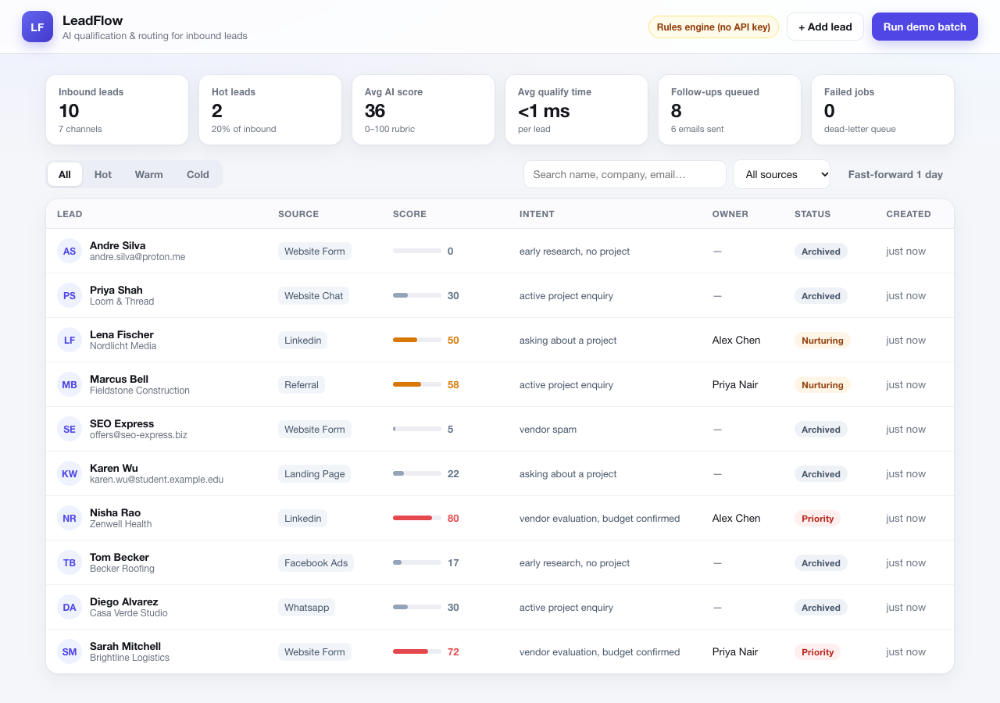

# LeadFlow — AI lead qualification & routing

A working reference implementation of the pipeline described in the Upwork brief
*"AI Automation Specialist Needed for Lead Generation, CRM Integration & n8n Workflows"*.

Inbound leads from several channels are normalised, scored against an ICP rubric,
routed to an owner with an SLA, upserted into a CRM, acknowledged instantly, and
put on a follow-up sequence. Every failure is retried and then parked in a
dead-letter queue instead of being dropped.



## Share a live link

The demo is a single Node process, so any tunnel works:

```bash
cloudflared tunnel --url http://127.0.0.1:8899          # or:
ssh -o StrictHostKeyChecking=no -R 80:localhost:8899 nokey@localhost.run
```

The URL changes when the tunnel restarts. The database lives in `data/state.json`,
so a restart keeps the leads.

## What it demonstrates

| Requirement from the brief | Where it lives |
| --- | --- |
| Lead capture from ads, landing pages, forms, messaging | `POST /api/leads` webhook + `app/seed.mjs` (7 source formats) |
| n8n workflows to connect platforms | `n8n/leadflow.workflow.json` (14-node importable workflow) |
| AI-powered qualification and routing | `app/llm.mjs` (OpenAI-compatible) + guardrails, deterministic fallback |
| Integration with an existing CRM | `createAdapters().crmUpsert()` — HubSpot/Pipedrive/webhook, deduped by email |
| Automated follow-ups and notifications | `followupPlan()` + ticker + sales alert adapter |
| Testing, error handling, documentation | 17 unit/integration tests, retries, idempotency, DLQ, this README + `docs/` |

## Quick start (no accounts or API keys needed)

```bash
cd cases/lead-pipeline
npm test                     # 17 tests, no network
PORT=8899 node app/server.mjs
# open http://127.0.0.1:8899
```

Click **Run demo batch** to push 10 fictional leads through the pipeline.
Click any row to see the qualification rationale, routing, CRM sync, follow-up
plan and full audit log.

To use a real model, point the adapter at any OpenAI-compatible endpoint:

```bash
LLM_BASE_URL=https://api.deepseek.com \
LLM_API_KEY=sk-... \
LLM_MODEL=deepseek-chat \
PORT=8899 node app/server.mjs
```

Without a key (or when the model errors), the deterministic rules engine takes
over and the lead is tagged `degraded: true` instead of being stalled — the
sales team still gets the lead on time.

### Optional side effects

```bash
CRM_WEBHOOK_URL=https://...   # POST each lead to your CRM
NOTIFY_WEBHOOK_URL=https://... # Slack-style notification for hot leads
WEBHOOK_SECRET=...            # require x-webhook-secret on /api/leads
```

## HTTP API

| Method | Path | Purpose |
| --- | --- | --- |
| `POST` | `/api/leads` | Inbound webhook. Supports `Idempotency-Key`. |
| `GET` | `/api/leads?tier=hot&source=linkedin` | List leads with qualification + events |
| `GET` | `/api/leads/:id` | One lead, full audit trail |
| `GET` | `/api/stats` | Dashboard metrics |
| `POST` | `/api/tick` | Send due follow-ups / raise SLA breaches (cron) |
| `GET` | `/api/health` | Liveness + which qualification engine is active |
| `POST` | `/api/demo/seed` · `/api/demo/advance` · `/api/demo/reset` | Demo helpers |

Example:

```bash
curl -s localhost:8899/api/leads -H 'content-type: application/json' -d '{
  "source": "facebook",
  "name": "Jane Cooper",
  "email": "jane@acme.com",
  "company": "Acme",
  "budget": "10k-20k",
  "timeline": "next month",
  "message": "We need to automate lead intake and routing. Can you send a proposal?"
}'
```

## Pipeline stages

```
webhook ─▶ normalise ─▶ qualify ─▶ guardrails ─▶ route ─┬─▶ hot:  alert + reply now
                                                        ├─▶ warm: reply + nurture
                                                        └─▶ cold: archive
                                   │
                                   └─▶ CRM upsert (dedupe by email)
                                        └─▶ follow-ups (day 1 / 3 / 7)
```

- **Idempotency** — webhook retries with the same key return the original lead.
- **Retries** — every outbound call retries with exponential backoff.
- **Dead-letter queue** — exhausted retries are stored with the failing stage.
- **SLA** — hot leads get a 15-minute first-touch target; breaches escalate.
- **Audit log** — every state change is recorded per lead and shown in the UI.

## Project layout

```
app/
  server.mjs      HTTP server, routes, static files
  pipeline.mjs    normalise → qualify → route → CRM → follow-ups
  llm.mjs         LLM adapter, prompt, guardrails, rules fallback
  store.mjs       atomic JSON store (swap for Postgres in production)
  seed.mjs        10 fictional leads across 7 channels
  public/         dashboard (vanilla JS, no build step)
tests/            17 tests: parsing, scoring, dedupe, retries, DLQ, persistence
n8n/              14-node importable n8n workflow (same pipeline)
docs/             architecture, case study, demo script
```

## Production notes

- The JSON store is deliberately simple; swap `Store` for Postgres when running
  multiple instances (the interface is 8 methods).
- Emails are written to an outbox/console in the demo. In production point
  `sendEmail` at Resend/SES/SMTP, and move the follow-up tick to n8n's Schedule
  Trigger or a queue worker.
- The LLM prompt lives in `llm.mjs` (`SYSTEM_PROMPT`) and is versioned in git.
  Re-score a sample of 50 leads after every prompt change.
- Personal data: the demo only uses fictional leads. In production, add
  retention rules and redact PII before sending to a third-party model.
