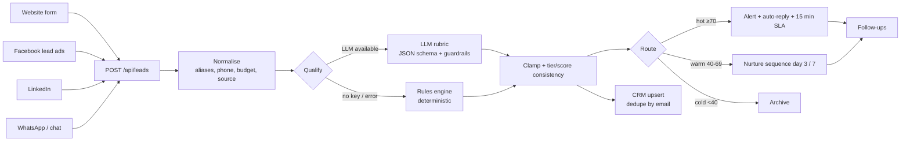

# Architecture

## Goals

1. **No lead is lost.** Every inbound lead ends up qualified, routed, and visible
   in the CRM — even when a third-party API is down.
2. **Fast first touch.** Hot leads are alerted and answered within minutes,
   not hours.
3. **Operable by a non-engineer.** The sales team sees why a lead scored what it
   did and can act on it without reading logs.

## Flow



## Design decisions

### Score, then enforce consistency
The model returns `{score, tier, ...}`. Guardrails recompute the tier from the
score (`hot ≥ 70`, `warm ≥ 40`), clamp to 0–100, and reject malformed JSON.
A model that says "cold, 95" cannot create an inconsistent record.

### Degrade, don't fail
Qualification has two implementations behind one contract:

- `qualifyWithLLM()` — OpenAI-compatible chat completion with `response_format:
  json_object`, 20s timeout.
- `heuristicQualify()` — deterministic rules used when there is no key or the
  model fails repeatedly.

The fallback is tagged `engine: "rules"`, `degraded: true` and surfaced in the UI,
so the team knows a human should double-check the score. Routing, CRM sync and
follow-ups still run.

### Idempotency
Webhook senders retry. `idempotencyKey` is either the caller's
`Idempotency-Key` header or a SHA-256 of `source|email|message`. A duplicate
returns the stored lead and logs `duplicate_ignored` instead of creating a
second record or a second email.

### Retries and the dead-letter queue
Every outbound side effect goes through `withRetry()` (3 attempts, exponential
backoff). If the CRM webhook still fails, the lead is **not** dropped: the
failure is written to `dlq[]` with the stage and error, the lead is marked
`crm_failed`, and the rest of the pipeline continues. The dashboard counts DLQ
entries so failures are visible rather than silent.

### SLA routing
Hot leads get an owner (round-robin), a 15-minute `sla_due`, and a notification.
`tick()` marks breaches as `sla_breached` and escalates. This is the metric the
business actually cares about: time-to-first-touch.

### Storage
A single JSON file with atomic writes (`tmp` + `rename`) and a serialised write
queue. It is intentionally boring: the `Store` interface is small enough to swap
for Postgres without touching the pipeline. Multi-instance deployments should do
exactly that.

## Data model

```ts
Lead {
  id, created_at, source, status,
  contact: { name, email, phone, company },
  message, budget_raw, budget_usd, timeline, utm, consent,
  qualification: {
    score, tier, intent, urgency, budget_fit,
    reasons[], missing_info[], flags[],
    next_action, draft_reply,
    engine, model, latency_ms, degraded, qualified_at
  },
  routing: { owner, queue, sla_due, notified, sla_breached },
  crm: { id, synced_at, target },
  followups: [{ step, due_at, sent_at, status, subject }]
}
Event { id, at, lead_id, type, message, meta }
```

## n8n parity

`n8n/leadflow.workflow.json` mirrors the same pipeline for teams that want to own
the automation visually:

| Node | Purpose |
| --- | --- |
| Webhook | `POST /lead-intake` |
| Normalize lead | field aliases, phone, budget (Code node) |
| LLM qualify | HTTP Request to any OpenAI-compatible endpoint, 3 retries |
| Guardrails | parse JSON, clamp score, deterministic fallback (Code node) |
| Route by tier | Switch: hot / warm / cold |
| CRM upsert | HTTP Request to HubSpot (swap for Airtable/GHL/Pipedrive) |
| Notify sales | Slack webhook |
| Auto-reply / Nurture email | Resend HTTP call |
| Wait 3 days → Day 3 follow-up | delayed follow-up |
| Error alert → Log failure | Error Trigger + dead-letter notification |

Credentials (`LLM_API_KEY`, CRM token, Resend key, Slack webhook) are the only
things to fill in; the workflow JSON contains no secrets.

## What I would change at 10× volume

- Postgres + a real queue (BullMQ/SQS) instead of a JSON file and a ticker.
- Move follow-ups into n8n Schedule Trigger or a worker so they survive restarts.
- Add an evaluation set of 50 hand-scored leads; run it on every prompt change
  and track precision/recall per tier.
- Emit OpenTelemetry spans per stage; alert on p95 qualification latency and DLQ
  growth.
- PII redaction before the LLM call, plus per-tenant data isolation if the
  pipeline becomes multi-client.
